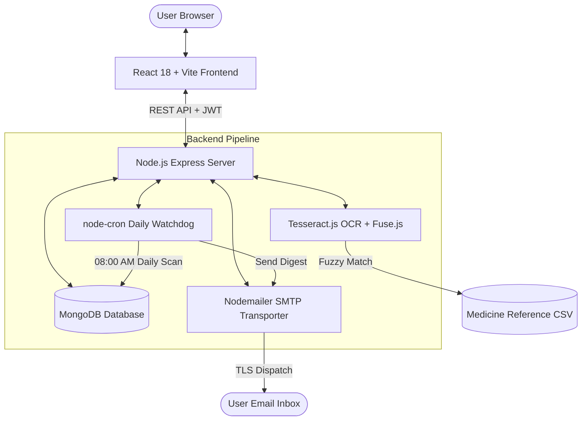

# 💊 MediCabinet — Intelligent Family Medicine & Expiry Tracker

> A modern, full-stack healthcare web application for managing family medicine cabinets, tracking expiry dates, preventing dangerous drug mix-ups, parsing packaging via AI OCR, and dispatching real-time email alerts.

[](#-tech-stack)
[](#-frontend)
[](#-backend)
[](#-database)
[](#-ai-packaging-scanner-ocr)
[](LICENSE)

---

## 📸 Visual Showcase

| Brand New 3D Smart Cabinet Landing Page | AI Camera Packaging OCR Scanner | Dedicated Multi-Profile Family Hub |
| :---: | :---: | :---: |
|  |  |  |
| *Modern Landing Page with Live Interactive Sandbox* | *Optical recognition of batch & expiry in < 1.5s* | *Zero mix-up isolation for Seniors, Kids & Adults* |

---

## 🌟 Key Highlights & Capabilities

### 1. 🚀 Brand New Modern Landing Page (`/`)
- **Stunning Light Theme**: Elegant white surface styling with vibrant crimson red accents (`#dc2626`) and ambient luminous glow effects.
- **Interactive Medicine Sandbox**: Test-drive live medicine cards directly in the browser—filter by *Expiring Soon*, *Low Stock*, or *Grandpa's Box*, and click *Take Dose* to observe real-time stock deduction.
- **Interactive OCR Scan Simulator**: Modal simulation demonstrating active laser scanning, neural text analysis, and instant field mapping.
- **Social Proof & Metrics**: Testimonials from physicians and caregivers, key adherence metrics, and an expandable FAQ accordion.
- **Smart Auth Awareness**: Automatically adapts buttons to *"Open Cabinet →"* for logged-in users and *"Get Started Free"* for guests.

### 2. 📸 AI Optical Packaging Scanner (OCR)
- Upload camera snapshots of medicine blister strips, boxes, or bottles.
- **Tesseract.js OCR engine** analyzes text contours, dot-matrix expiry timestamps, and embossed foil typography.
- **Fuse.js Fuzzy Matching**: Cross-references parsed text against an imported national formulary dataset (`medicine_reference.csv`), auto-populating:
  - **Brand Name** (e.g., *Augmentin 625 Duo*)
  - **Generic Name & Composition** (e.g., *Amoxicillin 500mg + Clavulanic Acid 125mg*)
  - **Batch Number** (e.g., *B24098*)
  - **Calculated Expiry Date** (e.g., *2026-10-18*)
  - **Indications / Primary Uses** (e.g., *Bacterial Infections*)
- Highlights uncertain fields in amber so users retain full editorial control before saving.

### 3. 🚨 24/7 Proactive Expiry & Safety Radar
- Automatically marks medicines with real-time status badges: `OK` (Valid), `Expiring Soon` (within 30 days), or `Expired`.
- **Low-Stock Alerting**: Monitors quantities against per-medicine threshold safety buffers.
- **Active Ingredient Duplicate Warning**: Flags when multiple medicines share identical active salts to prevent accidental double-dosing toxicity.

### 4. ✉️ Automated Real-Time & Scheduled Email Alerts
- **Immediate Event-Driven Dispatch**: Adding or editing a medicine that is expired or below stock threshold triggers an immediate email alert to the user's verified address.
- **Automated Daily Background Cron Job**: Evaluates the entire database every morning at 08:00 AM and dispatches aggregated email alerts with color-coded severity tags.
- **Audit Tracking**: Database models (`Medicine` and `Notification`) log email delivery status, timestamps, and recipient addresses.

### 5. 👨‍👩‍👧‍👦 Multi-Profile Family Segregation
- Create dedicated health spaces for Grandparents, Parents, Children, and Pets.
- Track individual blood groups, known allergies, chronic conditions, and custom dose schedules.
- Prevents cross-medication errors in multi-generational households.

### 6. ⏰ Precision Dose Scheduling & Stock Decrement
- Schedule medicines across morning, afternoon, evening, and bedtime routines.
- 1-click **"Mark Taken"** action automatically decrements inventory count, logs timestamp, and updates adherence analytics.

---

## 🏗️ Architecture & Data Flow



---

## 🗄️ Tech Stack

### Frontend (`/client`)
- **Core**: React 18, Vite 8, React Router DOM v6
- **Styling**: Vanilla CSS with custom Design Tokens (Light mode, `#dc2626` crimson brand accents)
- **Typography**: Google Fonts (*Outfit* for display headings, *Inter* for body text)
- **Charts & Visualization**: Recharts (adherence rate, inventory breakdown, waste spend)
- **HTTP Client**: Axios with request/response interceptors for automatic JWT header injection

### Backend (`/server`)
- **Runtime & Framework**: Node.js 18+, Express 4
- **Database & ODM**: MongoDB 8, Mongoose 8
- **Authentication**: JWT (JSON Web Tokens), bcryptjs password hashing (12 salt rounds)
- **Validation**: Zod schema validation on all mutation requests
- **Image Processing & OCR**: Multer, Tesseract.js, Fuse.js fuzzy search engine
- **Email Dispatch**: Nodemailer with SMTP transport (Gmail, Outlook, custom mail servers)
- **Scheduling**: node-cron (automated daily 08:00 AM scan)
- **Security**: Helmet HTTP headers, CORS origin whitelisting, express-rate-limit

---

## 📁 Repository Directory Structure

```
MediCabinet/
├── client/                               # React 18 Single Page Application
│   ├── public/                           # Static assets
│   │   ├── hero-3d.jpg                   # 3D smart cabinet render for landing page
│   │   ├── ocr-scan.jpg                  # Camera packaging OCR illustration
│   │   └── family-profiles.jpg           # Multi-profile glassmorphism mockup
│   ├── src/
│   │   ├── api/                          # Axios API service clients
│   │   ├── components/                   # Shared UI (AppLayout, Navbar, Sidebar, Modals, Toasts)
│   │   ├── context/                      # AuthContext, ToastContext
│   │   ├── pages/
│   │   │   ├── landing/                  # Brand new landing page (Landing.jsx & Landing.css)
│   │   │   ├── auth/                     # Login & Register views
│   │   │   ├── dashboard/                # Analytics charts, adherence & summary cards
│   │   │   ├── medicines/                # Cabinet inventory, OCR upload & filter tools
│   │   │   ├── profiles/                 # Family profile cards & allergy tracking
│   │   │   ├── schedules/                # Dose scheduling & daily timelines
│   │   │   └── emergency/                # Printable emergency medical card
│   │   ├── index.css                     # Global design tokens, light theme variables
│   │   └── App.jsx                       # Route provider & protected layouts
│   ├── index.html                        # HTML entry point with Outfit & Inter Google fonts
│   └── package.json
│
├── server/                               # Node.js Express REST API
│   ├── data/
│   │   └── medicine_reference.csv        # Comprehensive medicine composition formulary
│   ├── src/
│   │   ├── config/                       # Database connection (db.js)
│   │   ├── controllers/                  # Route business logic (auth, med, profile, schedule, etc.)
│   │   ├── middleware/                   # JWT auth guard, error handler, Zod validator
│   │   ├── models/                       # Mongoose schemas (User, Medicine, Profile, Schedule, etc.)
│   │   ├── routes/                       # Express router definitions
│   │   ├── services/                     # OCR engine (ocrService.js) & parser (parserService.js)
│   │   ├── jobs/                         # node-cron scheduled tasks (alertJob.js)
│   │   └── scripts/                      # seed.js (demo data) & importReference.js
│   ├── tests/
│   │   └── api.test.js                   # Jest + Supertest integration test suite
│   ├── index.js                          # Express app entry point
│   └── package.json
│
└── README.md                             # Monorepo documentation
```

---

## 🚀 Getting Started

### 1. Prerequisites
- **Node.js** v18 or higher (`node -v`)
- **npm** v9 or higher (`npm -v`)
- **MongoDB** running locally (`mongodb://127.0.0.1:27017`) or a [MongoDB Atlas](https://www.mongodb.com/atlas) connection URI

---

### 2. Installation

Clone the repository and install dependencies for both the backend and frontend:

```bash
# Clone repository
git clone https://github.com/your-username/MediCabinet.git
cd MediCabinet

# Install server dependencies
cd server
npm install

# Install client dependencies
cd ../client
npm install
```

---

### 3. Environment Configuration

#### Backend Configuration (`server/.env`)
Create a `.env` file in the `server/` directory:

```env
PORT=5000
NODE_ENV=development
MONGO_URI=mongodb://127.0.0.1:27017/medicabinet
JWT_SECRET=super_secret_jwt_key_make_this_random_and_long_12345
JWT_EXPIRES_IN=7d
CLIENT_URL=http://localhost:5173

# Optional: Real SMTP Email Alerts (e.g. Gmail)
SMTP_HOST=smtp.gmail.com
SMTP_PORT=587
SMTP_USER=your-email@gmail.com
SMTP_PASS=your-16-digit-app-password
SMTP_FROM=MediCabinet Alerts <your-email@gmail.com>
```

> **Note on Email:** If SMTP variables are omitted, email dispatches are gracefully skipped while in-app notifications continue to function seamlessly.

#### Frontend Configuration (`client/.env`)
Create a `.env` file in the `client/` directory:

```env
VITE_API_URL=http://localhost:5000/api
```

---

### 4. Database Initialization & Seeding

Import the drug database for OCR matching, then seed the demo environment:

```bash
# In the /server directory:
npm run import
# → Reads data/medicine_reference.csv and populates the Reference collection

npm run seed
# → Generates a demo user, 3 family profiles, 8 sample medicines, and 14 days of dose logs
```

**Demo Account Credentials:**
- **Email:** `demo@medicabinet.com`
- **Password:** `Demo@123`

---

### 5. Running the Application

Open two terminal windows:

```bash
# Terminal 1 — Start Backend Server (runs on http://localhost:5000)
cd server
npm run dev

# Terminal 2 — Start Frontend Client (runs on http://localhost:5173)
cd client
npm run dev
```

Visit [**http://localhost:5173**](http://localhost:5173) in your browser to experience the landing page, live interactive sandbox, and dashboard!

---

## 🌐 REST API Reference

All protected endpoints require the HTTP header:
`Authorization: Bearer <JWT_TOKEN>`

### Authentication (`/api/auth`)
| Method | Endpoint | Auth | Description |
|---|---|---|---|
| `POST` | `/api/auth/register` | Public | Register new user account |
| `POST` | `/api/auth/login` | Public | Authenticate user & return JWT |
| `GET` | `/api/auth/me` | JWT | Get authenticated user profile |

### Family Profiles (`/api/profiles`)
| Method | Endpoint | Auth | Description |
|---|---|---|---|
| `GET` | `/api/profiles` | JWT | Retrieve all profiles for current user |
| `POST` | `/api/profiles` | JWT | Create a new family profile |
| `PUT` | `/api/profiles/:id` | JWT | Update profile details, allergies, or notes |
| `DELETE` | `/api/profiles/:id` | JWT | Delete a profile |

### Medicine Cabinet (`/api/medicines`)
| Method | Endpoint | Auth | Description |
|---|---|---|---|
| `GET` | `/api/medicines` | JWT | List cabinet inventory (filters: `status`, `profileId`, `search`) |
| `POST` | `/api/medicines` | JWT | Add medicine (checks duplicate salt & triggers alerts) |
| `PUT` | `/api/medicines/:id` | JWT | Update stock, threshold, expiry date |
| `DELETE` | `/api/medicines/:id` | JWT | Remove medicine from cabinet |
| `POST` | `/api/medicines/scan` | JWT | Multipart upload of packaging image → returns parsed OCR data |
| `GET` | `/api/medicines/interactions/:id` | JWT | Check active ingredient overlap with other cabinet items |

### Schedules & Dose Logs (`/api/schedules` & `/api/doses`)
| Method | Endpoint | Auth | Description |
|---|---|---|---|
| `GET` | `/api/schedules` | JWT | List medication schedules |
| `POST` | `/api/schedules` | JWT | Create daily/weekly dose schedule |
| `PUT` | `/api/schedules/:id` | JWT | Toggle active state or update times |
| `DELETE` | `/api/schedules/:id` | JWT | Delete schedule |
| `GET` | `/api/doses` | JWT | Query dose logs by date or schedule |
| `POST` | `/api/doses/log` | JWT | Record dose (taken/missed) & automatically deducts stock |

### Analytics & Notifications (`/api/stats` & `/api/notifications`)
| Method | Endpoint | Auth | Description |
|---|---|---|---|
| `GET` | `/api/stats/summary` | JWT | Counts: Total, OK, Expiring, Expired, Low Stock |
| `GET` | `/api/stats/adherence` | JWT | Compliance percentage over 7, 14, or 30 days |
| `GET` | `/api/stats/waste` | JWT | Financial cost of expired discarded medications |
| `GET` | `/api/notifications` | JWT | Fetch notification feed with email delivery tags |
| `PATCH`| `/api/notifications/:id/read` | JWT | Mark notification as read |
| `DELETE`| `/api/notifications/clear` | JWT | Clear all notifications |

---

## 🧪 Testing

The backend is backed by an automated test suite verifying authentication security, multi-tenant data isolation, and stock decrements:

```bash
cd server
npm test
```

To verify the frontend production build:

```bash
cd client
npm run build
```

---

## 🛡️ Security & Privacy Guardrails

- **Strict Multi-Tenant Scoping**: Every database read, update, and delete query enforces `userId: req.user._id`. Users can never access or modify data belonging to another household.
- **Cryptographic Protection**: Passwords hashed with bcrypt (salt rounds = 12).
- **Hardened HTTP Headers**: Helmet enabled globally with secure framing policies.
- **CORS Protection**: Restricted specifically to the configured `CLIENT_URL`.
- **Zero Third-Party Medical Tracking**: No advertising cookies or analytics beacons touch patient prescription records.

---

## ⚖️ Medical Disclaimer

> **MediCabinet** is an organization, inventory tracking, and scheduling assistant. It is **not** a medical device, electronic prescribing tool, or a substitute for professional medical diagnosis, advice, or clinical treatment. Always verify medication directions with your physician or licensed pharmacist.

---

## 📄 License

This project is licensed under the [MIT License](LICENSE).
